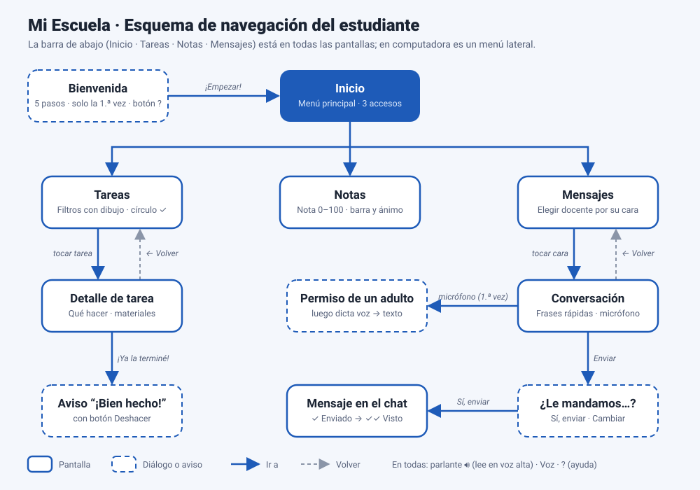

# Mi Escuela — prototipo de app escolar

Prototipo de interfaz (solo frente, sin backend) de una app escolar para **estudiantes de primer grado**, que en muchos casos todavía no saben leer. Permite:

- **Consultar tareas** — lista con filtros de dibujo, detalle de cada tarea (qué hay que hacer y qué materiales se necesitan) y un círculo para marcarla como hecha.
- **Ver notas** — de **0 a 100**, como en la escuela, con una barra de color, una rayita en el 65 (nota para aprobar), un mensaje de ánimo y el promedio.
- **Enviar mensajes al docente** — se elige a la maestra o maestro por su cara, se abre la conversación y se escribe con mensajes rápidos o dictando con la voz.



## Alcance

Solo el **flujo del estudiante**. El perfil del encargado (ver notas numéricas, aprobar permisos, varios hijos) queda fuera de este prototipo.

## Pensado para niños que no leen

- **Íconos ilustrados a color**, dibujados en SVG dentro del mismo archivo:
  - Secciones: casa, cuaderno, estrella y carta.
  - Materias: libro, bloques 1 2 3, planta, mundo, bandera inglesa, bola y notas musicales.
  - Logo: una mochila, distinta de la casa de Inicio.
- **El tiempo con dibujos:**
  - Sol = hoy; luna = mañana (después de dormir).
  - Calendario con puntitos = días que faltan; triángulo = atrasada; check = hecha.
- **Notas que se entienden sin leer números:** cada nota de 0 a 100 va con una barra (más llena = mejor) y un ánimo: 90–100 ¡Excelente!, 70–89 ¡Muy bien!, menos de 70 ¡Vamos a practicar! Nunca se muestra una carita triste ni un rojo de "reprobado".
- **Lectura en voz alta** con una voz neuronal costarricense grabada: cada pantalla, tarea, estrella y mensaje tiene un parlante. Con la **ayuda de voz** encendida (botón "Voz"), la app dice en qué pantalla estás y confirma lo que hiciste.
- **Dictado (voz a texto)** con un micrófono rojo grande, y un parlante para escuchar el mensaje antes de mandarlo.
- **Bienvenida guiada** de 5 pasos la primera vez. Se repite con el botón **?**.

## Cambios por la auditoría de IHC

| Problema encontrado | Heurística | Solución |
|---|---|---|
| Un mensaje rápido borraba lo que el niño había dictado | Prevención de errores | La frase se agrega al final del texto |
| Marcar una tarea por error no se podía deshacer | Control y libertad | Aviso con botón **Deshacer**, y botón "Hecha · Deshacer" en el detalle |
| Se enviaba sin confirmar a quién | Prevención de errores | Diálogo "¿Le mandamos este mensaje a Niña Ana?" con su cara, el texto y un parlante |
| El logo y el ícono de Inicio eran casi iguales | Consistencia | Logo de mochila |
| El mismo cuaderno significaba "Tareas" y "Todas" | Consistencia | "Todas" usa cuatro cuadritos de colores |
| El ícono de Inglés tenía texto ("Hi!") | Reconocer antes que recordar | Bandera inglesa |
| Las fechas ("jue, 29 oct") no sirven a quien no lee | Correspondencia con el mundo real | Sol, luna y calendario con puntitos |
| Un número solo ("67") no le dice nada a un niño de 6 años | Correspondencia con el mundo real | Barra de color, rayita del 65, mensaje de ánimo y lectura en voz alta |
| La carita triste en rojo podía avergonzar | Diseño emocional | "¡Vamos a practicar!" en ámbar, nunca rojo |
| El check y el parlante estaban muy juntos | Prevención de errores (motricidad fina) | Check de 56 px a un lado, parlante abajo, separados |
| No había detalle de tarea ni conversación por docente | Reconocer antes que recordar | Pantallas **Detalle de tarea** y **Conversación** |
| No se sabía si la docente leyó el mensaje | Visibilidad del estado | "✓ Enviado" y luego "✓✓ Visto" |
| No había ayuda | Ayuda y documentación | Bienvenida de 5 pasos y botón **?** |
| El niño podía usar el micrófono sin un adulto | Privacidad de menores | La primera vez pide "Pedile ayuda a un adulto" |
| Todos los parlantes decían solo "Escuchar" | Accesibilidad (WCAG 2.4.6) | Cada uno dice qué lee ("Escuchar tarea: …") |
| El cambio de pantalla no se anunciaba | Accesibilidad (WCAG 4.1.3) | El foco pasa al título de la nueva pantalla |
| Las animaciones no respetaban la preferencia del sistema | Accesibilidad (WCAG 2.3.3) | `prefers-reduced-motion` las apaga |
| El texto ámbar y verde pequeño tenía poco contraste | Accesibilidad (WCAG 1.4.3) | Tonos más oscuros (#8F5600 y #17703D) |

## Cómo funciona sin backend

| Archivo | Qué tiene |
|---|---|
| `index.html` | La interfaz: HTML, CSS, íconos SVG y la lógica de pantallas (sin librerías) |
| `datos.js` | Los datos de ejemplo (tareas, notas, docentes, mensajes) y **todo lo que la app dice en voz alta** |
| `audio/` | Un `.mp3` por frase, `frases.json` (la lista) e `indice.json` (los que existen) |
| `herramientas/` | Los scripts que generan los audios |
| `esquema-navegacion.svg` | El esquema de navegación |

- Las tareas hechas, los mensajes enviados y las preferencias se guardan en el navegador con `localStorage`. El "Visto" de la docente se simula a los 4 segundos.
- La navegación usa `#inicio`, `#tareas`, `#tarea/1`, `#notas`, `#mensajes` y `#chat/ana`. El botón Atrás funciona y se puede abrir cualquier pantalla directo.

## La voz: que lea bien en español

La voz del navegador depende del dispositivo: unos traen voces buenas, otros robóticas, y algunos no traen ninguna en español (entonces leen con acento inglés). Por eso la app usa dos niveles:

1. **Audios grabados (lo principal).** Todas las frases que se conocen de antemano tienen su `.mp3`, generado con **María, una voz neuronal costarricense** (`es-CR-MariaNeural`), a un 8 % más lento para niños. Son 115 audios (3.5 MB) que suenan igual en cualquier celular o computadora. Las partes en inglés (los colores, el mensaje de Teacher Jorge) usan una voz en inglés (`en-US-JennyNeural`), para que el niño escuche la pronunciación correcta.
2. **Voz del navegador (respaldo).** Lo que no se puede grabar antes, como lo que dicta el niño, se lee con `speechSynthesis`. La app elige la voz más natural que tenga el dispositivo, en este orden:
   1. Neuronales de Edge.
   2. "Premium" o "Mejorada" de Apple.
   3. Google.
   4. Paulina, Mónica… con preferencia por el acento latinoamericano.

   Las voces de efectos de macOS (Eddy, Grandma…) quedan al final. Si el dispositivo no tiene ninguna voz en español, la app lo avisa.

Cada frase se identifica por un hash de su texto (`audio/<id>.mp3`). En `datos.js`, `|` separa partes que se leen seguidas y `[en]` marca una parte en inglés. Una frase mixta como "¿Le mandamos este mensaje a Niña Ana? | *(lo que dictó el niño)*" reproduce la primera parte grabada y la segunda con la voz del navegador.

**Regenerar los audios** después de cambiar un texto en `datos.js` (necesita Python 3 y Node):

```bash
python3 -m venv .venv && .venv/bin/pip install edge-tts
.venv/bin/python herramientas/generar_audios.py
```

Solo genera las frases nuevas y actualiza `audio/indice.json`. `edge-tts` usa el servicio gratuito de lectura en voz alta de Microsoft Edge. Para un producto real convendría Azure Speech con licencia, o grabar a una maestra de verdad con los mismos nombres de archivo.

**Dictado.** `SpeechRecognition` funciona en Chrome, Edge y Safari, pero no en Firefox. Necesita `https` (GitHub Pages ya lo da) y permiso del micrófono. En Chrome el audio se procesa en los servidores de Google, así que hace falta internet.

## Publicar en GitHub Pages

1. Crear un repositorio y subir todo el contenido de la carpeta (`index.html`, `datos.js`, `audio/`, `herramientas/`, `esquema-navegacion.svg` y este README).
2. En **Settings → Pages**, elegir *Deploy from a branch*, rama `main`, carpeta `/ (root)`.
3. La página queda en `https://<usuario>.github.io/<repositorio>/`.

Los audios necesitan que la página se abra desde un servidor (GitHub Pages o `python3 -m http.server`). Si se abre `index.html` con doble clic, la app sigue funcionando, pero lee todo con la voz del navegador.

## Decisiones de diseño

- **Azul y blanco:** el azul transmite confianza y orden (color institucional); el blanco deja las tarjetas limpias y fáciles de leer.
- **Verde, ámbar y rojo** se usan solo para estados, y siempre van con un dibujo: el color nunca es la única señal.
- **Menú principal** con tres accesos grandes de dibujo y una sola palabra.
- **Navegación:** barra inferior de 4 pestañas en el celular y menú lateral en computadora; la sección activa se marca en azul y su dibujo crece. Las pantallas de detalle tienen un botón **← Volver** arriba.
- **Botones grandes:** el círculo de "hecha" mide 56 px, el micrófono 76 px y los parlantes 48 px, para dedos pequeños.
